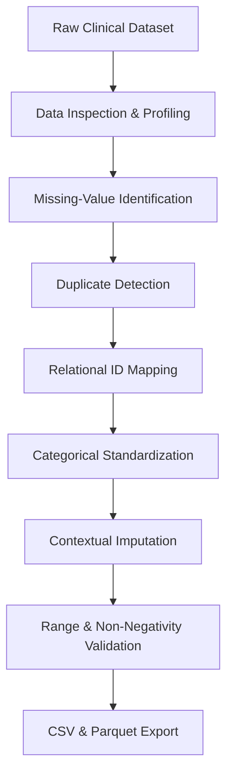

# SWYNEX – Clinical Data Preparation
## Task 1: Data Preparation

This project was completed as part of my internship at **SWYNEX Technologies**.  
The objective of this task was to prepare a real-world clinical dataset for downstream data-science analysis by identifying and handling data-quality issues, including missing values, inconsistent data types, duplicate records, and categorical inconsistencies.

---

## Dataset
- **Dataset**: Diabetes 130-US Hospitals for Years 1999–2008
- **Source**: UCI Machine Learning Repository
- **Domain**: Healthcare Analytics / Clinical Informatics
- **Scope**: 101,766 clinical hospital encounters across 130 US hospital facilities containing 50 initial clinical, demographic, and administrative variables.

---

## Objectives
- **Inspect** the raw dataset (`df.shape`, `df.info()`, `df.describe()`, `df.head()`).
- **Identify** explicit (`NaN`) and implicit (`?`, `Unknown/Invalid`) missing values.
- **Detect** duplicate records and distinguish encounter-level primary keys from repeat patient admissions.
- **Validate** and convert feature data types to appropriate physical representation.
- **Standardize** categorical values, age brackets, medication codes, and ICD-9 diagnosis categories.
- **Handle** missing and invalid values using context-appropriate clinical imputation rather than naive row deletion (`dropna()`).
- **Document** all data-preparation decisions under a formal **Problem → Decision → Reason** governance framework.
- **Validate** the clean dataset through statistical boundary and integrity checks.
- **Export** the prepared dataset in both CSV and Apache Parquet formats for future EDA and 30-day hospital readmission predictive modeling.

---

## Repository Structure
```
SWYNEX-Data-Preparation/
├── data/
│   ├── raw/
│   │   ├── diabetic_data.csv          # Raw clinical encounter dataset
│   │   └── IDS_mapping.csv            # Relational ID mapping dictionary
│   └── processed/
│       ├── diabetic_data_clean.csv    # Exported clean dataset (CSV)
│       └── diabetic_data_clean.parquet# Exported clean dataset (Parquet)
├── src/
│   ├── __init__.py                    # Core package init
│   └── utils.py                       # Modular data cleaning functions
├── tests/
│   └── test_preprocessing.py          # Pytest unit tests
├── docs/
│   └── DATA_DICTIONARY.md             # Dataset schema documentation
├── .github/workflows/
│   └── test.yml                       # CI testing pipeline
├── SWYNEX_Data_Preparation.ipynb      # Main execution Jupyter Notebook
├── requirements.txt                   # Dependency specifications
└── README.md                          # Repository documentation
```

---

## Data Preparation Workflow


---

## Key Data-Quality Issues & Treatments

| Issue Identified | Treatment Applied |
| :--- | :--- |
| **Implicit Missing Values (`?`)** | Replaced with standard `NaN` and imputed contextually based on clinical meaning. |
| **Extreme Missingness (`weight` >96.8%)** | Dropped column to eliminate noise and artificial variance. |
| **Administrative Missingness (`payer_code`, `medical_specialty`)** | Retained as explicit `'Missing'` category (informative missingness). |
| **Demographic Missingness (`race` 2.23%)** | Imputed as `'Unknown'` to preserve valid encounter records. |
| **Invalid Demographics (`gender` 3 records)** | Filtered out 3 invalid records (<0.003% of dataset). |
| **Duplicate Records** | 0 exact row duplicates; 101,763 unique encounter IDs preserved. |
| **Incorrect Data Types & IDs** | Mapped integer keys (`admission_type_id`, etc.) via `IDS_mapping.csv` to descriptive text labels. |
| **Zero-Variance Features (`examide`, `citoglipton`)** | Dropped constant features carrying zero statistical entropy. |
| **High-Cardinality Diagnoses** | Mapped 900+ ICD-9 codes into 9 primary clinical disease categories (Circulatory, Diabetes, Respiratory, etc.). |

---

## Preprocessing Assumptions & Decisions

Every major cleaning decision was framed under the **Problem → Decision → Reason** matrix:

1. **Implicit Missing Indicators (`?`)**  
   *Problem*: Raw dataset encodes missingness as `'?'` strings.  
   *Decision*: Converted all `'?'` entries to standard `NaN`.  
   *Reason*: Standardizes pandas missingness handling and prevents placeholder strings from corrupting statistical functions.

2. **Extreme Missingness in `weight` (96.85%)**  
   *Problem*: `weight` feature is missing in 98,569 out of 101,766 records.  
   *Decision*: Excluded `weight` feature from the dataset.  
   *Reason*: Imputing >96% of data would introduce extreme artificial bias and noise without providing clinical value.

3. **Informative Missingness in Administrative Features (`payer_code` & `medical_specialty`)**  
   *Problem*: High missing rates in `payer_code` (39.56%) and `medical_specialty` (49.08%).  
   *Decision*: Encoded missing values as an explicit category `'Missing'`.  
   *Reason*: Missingness in administrative attributes often correlates with self-pay/uninsured status or unassigned specialty (informative missingness); preserving it avoids dropping ~50% of hospital encounters.

4. **Zero-Variance Features (`examide` & `citoglipton`)**  
   *Problem*: `examide` and `citoglipton` contain identical values (`'No'`) across all rows.  
   *Decision*: Dropped both columns.  
   *Reason*: Zero variance features provide zero predictive signal or information entropy.

5. **High Cardinality in ICD-9 Diagnosis Codes**  
   *Problem*: Raw diagnosis columns (`diag_1`, `diag_2`, `diag_3`) contain over 900 distinct codes.  
   *Decision*: Mapped codes into 9 clinical categories (Circulatory, Respiratory, Digestive, Diabetes, Injury, Musculoskeletal, Genitourinary, Neoplasms, Other).  
   *Reason*: Reduces feature space sparsity, mitigates overfitting risk, and standardizes features according to clinical literature.

---

## Tools & Setup
- **Python 3.12**
- **Dependencies**: `pandas`, `numpy`, `matplotlib`, `seaborn`, `pyarrow`, `pytest`

### Setup Instructions
```bash
# Clone the repository
git clone https://github.com/AbhijeetArunGore/SWYNEX-Data-Preparation.git
cd SWYNEX-Data-Preparation

# Install requirements
pip install -r requirements.txt

# Run unit tests
pytest tests/
```

---

## Output
The final cleaned dataset is stored in `data/processed/`:
- `diabetic_data_clean.csv` (101,763 rows x 47 features, 0 null values)
- `diabetic_data_clean.parquet` (Optimized column-oriented binary format)

---

## Future Scope
This prepared dataset serves as the standardized clinical baseline for:
- **Task 2**: Comprehensive Exploratory Data Analysis (EDA) & Clinical Hypothesis Testing.
- **Task 3**: Predictive Machine Learning Modeling for 30-Day Hospital Readmission Risk.

---

## Author
**Abhijeet Arun Gore**  
Data Science Intern, SWYNEX Technologies  
GitHub: [AbhijeetArunGore](https://github.com/AbhijeetArunGore)

---

## License & Attribution
This project is created for internship evaluation at **SWYNEX Technologies**.
Dataset sourced from UCI Machine Learning Repository.
