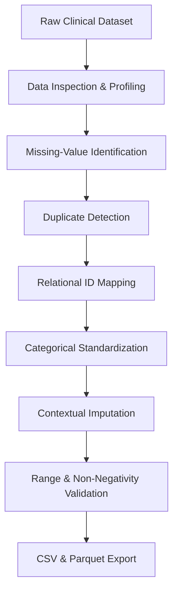

# SWYNEX – Clinical Data Preparation
## Task 1: Data Preparation

This project was completed as part of my internship at **SWYNEX Technologies**.  
The objective of this task was to prepare a real-world clinical dataset for downstream data-science analysis by identifying and handling data-quality issues, including missing values, inconsistent data types, duplicate records, and categorical inconsistencies.

---

## Dataset
- **Dataset**: Diabetes 130-US Hospitals for Years 1999–2008
- **Source**: UCI Machine Learning Repository
- **Domain**: Healthcare Analytics / Clinical Informatics
- **Scope**: 101,766 clinical hospital encounters across 130 US hospital facilities containing 50 initial clinical, demographic, and administrative variables.

---

## Objectives
- **Inspect** the raw dataset (`df.shape`, `df.info()`, `df.describe()`, `df.head()`).
- **Identify** explicit (`NaN`) and implicit (`?`, `Unknown/Invalid`) missing values.
- **Detect** duplicate records and distinguish encounter-level primary keys from repeat patient admissions.
- **Validate** and convert feature data types to appropriate physical representation.
- **Standardize** categorical values, age brackets, medication codes, and ICD-9 diagnosis categories.
- **Handle** missing and invalid values using context-appropriate clinical imputation rather than naive row deletion (`dropna()`).
- **Document** all data-preparation decisions under a formal **Problem → Decision → Reason** governance framework.
- **Validate** the clean dataset through statistical boundary and integrity checks.
- **Export** the prepared dataset in both CSV and Apache Parquet formats for future EDA and 30-day hospital readmission predictive modeling.

---

## Repository Structure
```
SWYNEX-Data-Preparation/
├── data/
│   ├── raw/
│   │   ├── diabetic_data.csv          # Raw clinical encounter dataset
│   │   └── IDS_mapping.csv            # Relational ID mapping dictionary
│   └── processed/
│       ├── diabetic_data_clean.csv    # Exported clean dataset (CSV)
│       └── diabetic_data_clean.parquet# Exported clean dataset (Parquet)
├── src/
│   ├── __init__.py                    # Core package init
│   └── utils.py                       # Modular data cleaning functions
├── tests/
│   └── test_preprocessing.py          # Pytest unit tests
├── docs/
│   └── DATA_DICTIONARY.md             # Dataset schema documentation
├── .github/workflows/
│   └── test.yml                       # CI testing pipeline
├── SWYNEX_Data_Preparation.ipynb      # Main execution Jupyter Notebook
├── requirements.txt                   # Dependency specifications
└── README.md                          # Repository documentation
```

---

## Data Preparation Workflow


---
